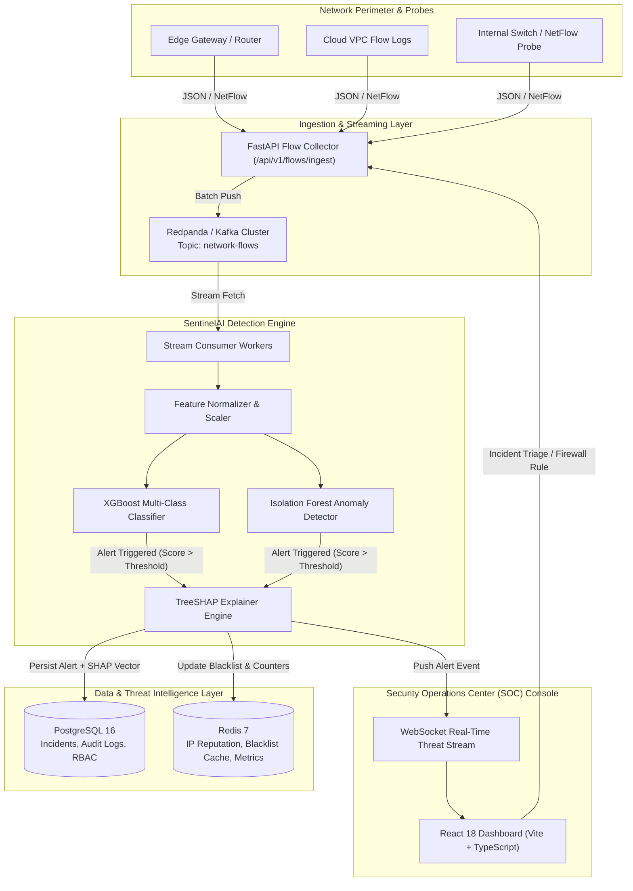
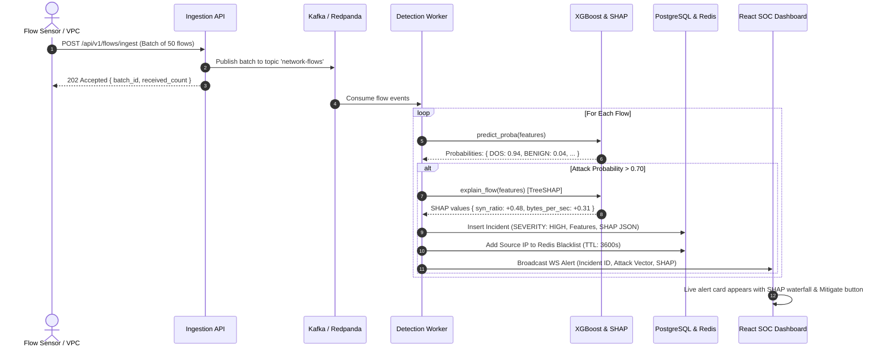
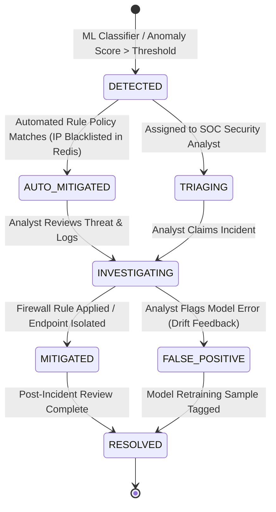
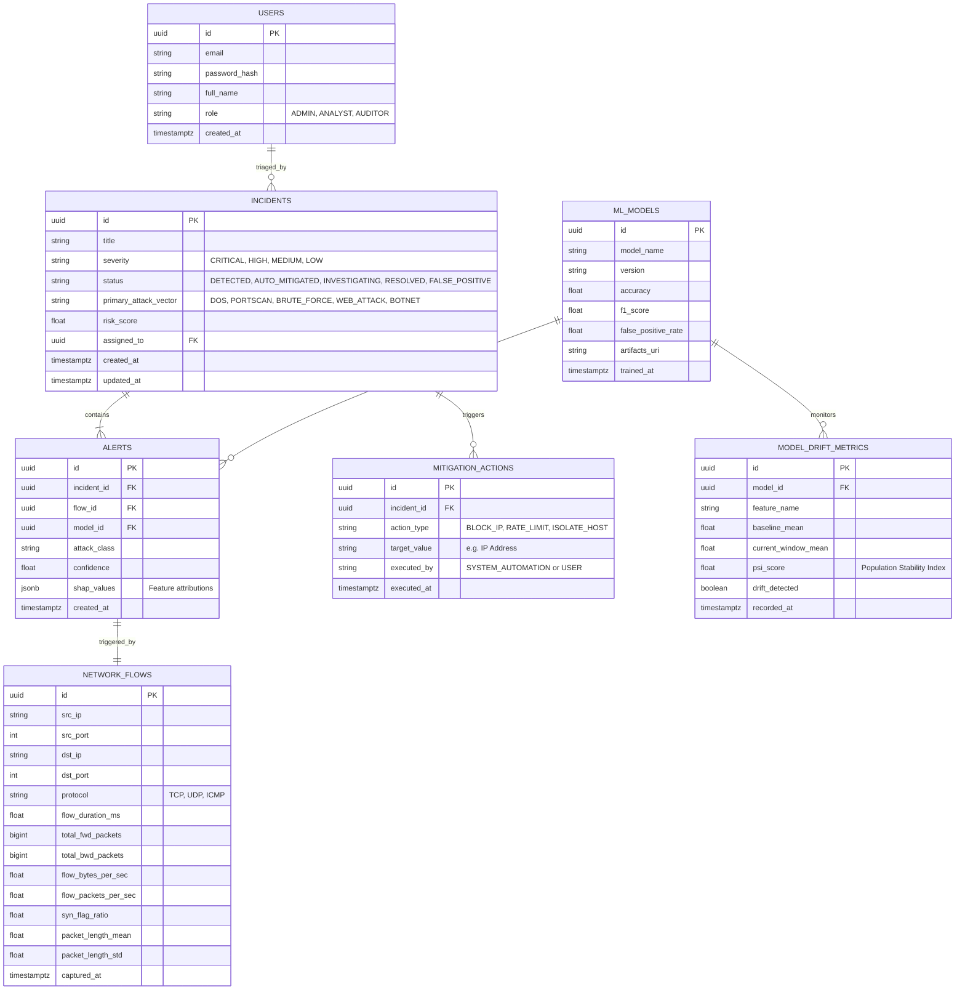

# 🛡️ SentinelAI — Real-Time AI-Powered Network Intrusion Detection & Response Platform
## Complete Architecture & Engineering Specification

---

## 1. Executive Summary & Vision

**SentinelAI** is an enterprise-grade Network Detection & Response (NDR) platform designed for modern Security Operations Centers (SOC). Modern enterprise networks process millions of network flows per minute across hybrid-cloud perimeters. Traditional rule-based Intrusion Detection Systems (such as basic Snort/Suricata signature matches) fail against zero-day exploits, distributed volumetric attacks, and polymorphic adversary techniques.

SentinelAI combines **real-time streaming flow ingestion (Redpanda/Kafka)**, **machine learning classification (XGBoost)**, **unsupervised zero-day anomaly detection (Isolation Forest)**, and **Explainable AI (TreeSHAP)** to detect, score, explain, and mitigate network threats within sub-second latencies.

Every detected threat is accompanied by transparent, audit-ready SHAP feature importance attributions, allowing security analysts to immediately understand *why* a connection was classified as an attack (e.g., abnormally high SYN-to-ACK ratio, anomalous packet length variance, or high flow packet velocity).

---

## 2. Core Architectural Pillars

| Component | Technology | Rationale & Tradeoffs | Role in SentinelAI |
|---|---|---|---|
| **API & Ingestion Gateway** | **Python 3.14 & FastAPI** | Asynchronous ASGI runtime with native `uvicorn`, automatic OpenAPI schema generation, and high-concurrency non-blocking I/O. | Ingests network flow telemetry, exposes incident triage REST APIs, and streams live threat alerts over WebSockets. |
| **Streaming Message Broker** | **Redpanda / Apache Kafka** | Distributed commit log capable of millions of events/sec with zero packet loss, partitioned ordering, and decoupled stream consumers. | Buffers continuous network flow streams from boundary agents, decoupling ingestion from ML inference. |
| **ML Inference Engine** | **XGBoost & Scikit-learn** | High-performance gradient boosted decision trees optimized for tabular network flow statistics; ultra-fast inference latency (< 5ms per flow). | Multi-class classification: `BENIGN`, `DOS_DDOS`, `PORTSCAN`, `BRUTE_FORCE`, `WEB_ATTACK`, `BOTNET`. |
| **Explainable AI (XAI)** | **SHAP (TreeSHAP)** | Game-theoretic Shapley Additive exPlanations providing mathematically sound local and global feature attribution. | Computes per-feature contributions ($\phi_i$) for every flagged threat, explaining root causes directly in the SOC console. |
| **State & Threat Cache** | **Redis 7** | In-memory key-value store with sub-millisecond lookups, TTL expirations, and Pub/Sub. | Tracks IP reputation, sliding-window traffic frequencies, active firewall blacklist rules, and session state. |
| **Relational Storage** | **PostgreSQL 16** | ACID-compliant storage with JSONB indexing and relational integrity. | Stores user RBAC, persistent incident audit trails, mitigation logs, and model drift telemetry. |
| **Frontend SOC Console** | **React 18 + TypeScript + Vite** | Component-driven dark UI with live WebSocket streaming, visual SHAP waterfall charts, and incident management controls. | Provides security analysts with real-time threat maps, incident triaging, XAI breakdowns, and manual/automated mitigations. |

---

## 3. Detailed Technology Pillar Breakdown

### Pillar 1: FastAPI Ingestion & Control Gateway
- **Definition:** An asynchronous web framework built on Starlette and Pydantic for building modern APIs with Python.
- **Why Using:** Python is the native lingua franca for machine learning (XGBoost, SHAP, PyTorch). FastAPI achieves near-Go/Node performance using `asyncio` and `uvloop`, allowing simultaneous low-latency ML inference and high-throughput ingestion without cross-language serialization bottlenecks.
- **Purpose in SentinelAI:** Serves as the central API gateway: accepts network flow bundles, validates schemas via Pydantic, broadcasts live threats via WebSockets, and manages incident status transitions.

### Pillar 2: Redpanda / Kafka Stream Broker
- **Definition:** A high-throughput, partitioned, fault-tolerant distributed streaming log.
- **Why Using:** Network packet collectors (such as NetFlow v9, IPFIX, or sFlow probes) generate bursts of thousands of flow events per second. Direct synchronous database writes or synchronous ML calls would drop packets under traffic spikes.
- **Purpose in SentinelAI:** Decouples flow ingestion from detection workers. Probes publish to `network-flows` topic; ML worker pools consume concurrently and push evaluated threats to `threat-alerts`.

### Pillar 3: XGBoost Multi-Class Classification & Anomaly Detection
- **Definition:** An optimized distributed gradient boosting library implementing machine learning algorithms under the Gradient Boosting framework.
- **Why Using:** Deep learning models (e.g. LSTMs or CNNs) are computationally heavy for line-rate packet flow metadata, whereas gradient boosted trees consistently dominate tabular benchmarks (like CIC-IDS2017 and UNSW-NB15) with microsecond inference times and compact memory footprints.
- **Purpose in SentinelAI:** Evaluates 20+ statistical network features per flow to compute multi-class probability distributions across attack vectors and normal baseline traffic.

### Pillar 4: Explainable AI with TreeSHAP
- **Definition:** A tree-specific optimization of the SHAP algorithm that computes exact Shapley values in polynomial time $\mathcal{O}(TLD^2)$ rather than exponential time.
- **Why Using:** "Black-box" AI is dangerous in cybersecurity. False positive alerts waste analyst time and can disrupt legitimate enterprise traffic. SHAP provides mathematically consistent, local explanation vectors proving exactly which network attributes triggered the alarm.
- **Purpose in SentinelAI:** Generates local feature attribution scores for every security alert, displayed in the dashboard as positive and negative risk contributors (e.g. `+0.42` for Destination Port 445 SMB anomaly, `+0.38` for SYN flag ratio).

---

## 4. Architectural Diagrams (Mermaid)

### 4.1 End-to-End System Architecture

---

### 4.2 Real-Time Detection & Explanation Sequence Diagram

---

### 4.3 Security Incident Lifecycle State Machine

---

### 4.4 Entity-Relationship Diagram (ERD)

---

## 5. Implementation Stages Roadmap

### Stage A: Essential Product
- Ingestion REST API (`POST /api/v1/flows/ingest`)
- Pre-trained XGBoost model with realistic CIC-IDS2017 feature engineering
- Real-time TreeSHAP local explanation generation
- PostgreSQL persistence for incidents and flows
- React SOC Dashboard: Threat Overview, Alerts Feed, and SHAP Explainability Drawer
- Dual authentication & RBAC (Admin & Analyst roles)

### Stage B: Engineering Depth
- Redpanda / Kafka streaming message queue integration
- Redis high-speed IP reputation cache and blacklist enforcement
- Automated mitigation engine (simulated firewall iptables rules & IP blocking)
- WebSocket real-time live threat streaming to frontend
- Incident lifecycle triaging (DETECTED $\to$ INVESTIGATING $\to$ MITIGATED $\to$ RESOLVED)

### Stage C: Production Scale & MLOps
- Model drift monitoring (PSI & Kolmogorov-Smirnov statistical tests)
- Prometheus security telemetry metrics & Grafana monitoring dashboards
- Synthetic network flow replay generator for high-volume stress testing
- Docker Compose multi-container deployment
- Complete end-to-end test suite
