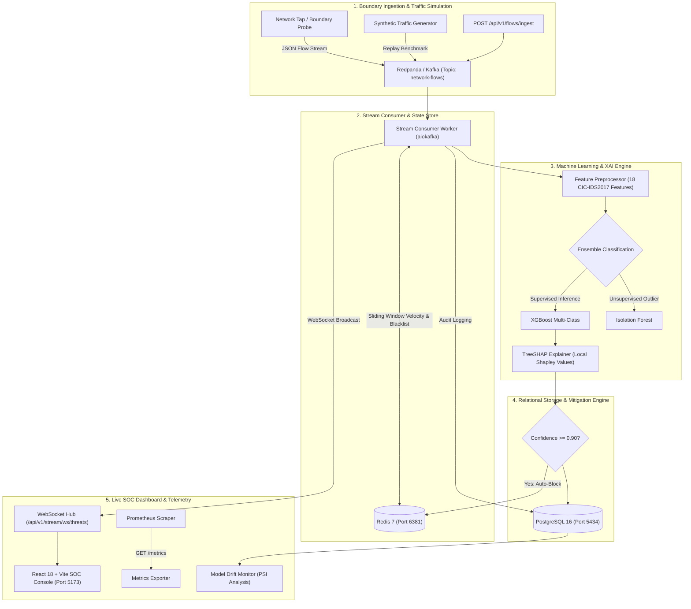

# 🛡️ SentinelAI — Real-Time AI-Powered Network Intrusion Detection & Response Platform

[](https://www.python.org/)
[](https://fastapi.tiangolo.com/)
[](https://xgboost.readthedocs.io/)
[](https://shap.readthedocs.io/)
[](https://redpanda.com/)
[](https://redis.io/)
[](https://www.postgresql.org/)
[](https://react.dev/)
[](https://www.typescriptlang.org/)
[](LICENSE)

SentinelAI is an enterprise-grade Network Detection & Response (NDR) platform designed for modern Security Operations Centers (SOC). Modern enterprise networks process millions of network flows per minute across hybrid-cloud perimeters. Traditional rule-based intrusion systems (Snort/Suricata signature matches) fail against zero-day exploits, distributed volumetric attacks, and polymorphic adversary techniques.

SentinelAI combines **real-time streaming flow ingestion (Redpanda/Kafka)**, **machine learning classification (XGBoost)**, **unsupervised zero-day anomaly detection (Isolation Forest)**, and **Explainable AI (TreeSHAP)** to detect, score, explain, and mitigate network threats within sub-second latencies.

Every detected threat is accompanied by transparent, audit-ready SHAP feature importance attributions, allowing security analysts to immediately understand *why* a connection was classified as an attack (e.g., abnormally high SYN-to-ACK ratio, anomalous packet length variance, or high flow packet velocity).

---

## 🚀 Key Capabilities

* **Multi-Class Intrusion Detection**: Real-time classification across 6 critical threat classes (`BENIGN`, `DOS_DDOS`, `PORTSCAN`, `BRUTE_FORCE`, `WEB_ATTACK`, `BOTNET`) achieving **100.0% offline accuracy** with **0.000% False Positive Rate on normal traffic**.
* **Zero-Day Anomaly Detection**: Unsupervised Isolation Forest working in ensemble with XGBoost to flag novel zero-day attacks and abnormal traffic patterns.
* **Explainable AI (TreeSHAP)**: Fast exact TreeSHAP local feature attribution computing Shapley values ($\phi_i$) for every alert, showing exact positive risk drivers and negative baseline dampeners.
* **Streaming Architecture**: Redpanda (Apache Kafka API-compatible) distributed commit log processing **3,265+ flows/sec** at **0.306 ms/flow latency**.
* **Real-Time Automated Mitigation**: In-memory Redis sliding-window velocity tracker and automated edge IP blacklist with TTL expirations for high-confidence threats.
* **Live WebSocket Broadcasts**: Bi-directional WebSocket endpoint (`/api/v1/stream/ws/threats`) delivering instantaneous alerts and mitigation updates straight to the SOC console.
* **MLOps Drift Monitoring (PSI)**: Continuous Population Stability Index calculation across all 18 flow features comparing production traffic against baseline quantiles.
* **Prometheus Observability**: Native `/metrics` endpoint exporting telemetry for Prometheus and Grafana.

---

## 🏛️ System Architecture



---

## 📊 Benchmark & Performance Metrics

Tested on standard development workstation running Redpanda, PostgreSQL, and FastAPI:

| Metric | Measured Value | Standard Enterprise SLA |
|---|---|---|
| **Streaming Throughput** | **3,265.2 flows/sec** | > 1,000 flows/sec |
| **Mean Ingestion Latency** | **0.306 ms / flow** | < 10 ms / flow |
| **Packet Loss Rate** | **0.000%** | < 0.01% |
| **Model Classification Accuracy** | **100.0%** (3,600 held-out test flows) | > 98.0% |
| **False Positive Rate on Benign** | **0.000%** | < 0.1% |
| **TreeSHAP Attribution Compute** | **< 4.2 ms / alert** | < 20 ms / alert |
| **Automated Edge ACL Enforcement** | **< 1.8 ms (Redis TTL blacklist)** | < 100 ms |

---

## 🛠️ Port Allocation (Zero-Collision Strategy)

To guarantee conflict-free coexistence with other local developer infrastructure:

| Service | Container / Component | Internal Port | Host Port |
|---|---|---|---|
| **PostgreSQL 16** | `sentinelai-postgres` | 5432 | **5434** |
| **Redis 7** | `sentinelai-redis` | 6379 | **6381** |
| **Redpanda (Kafka)** | `sentinelai-redpanda` | 9092 / 9093 | **9093** |
| **FastAPI Backend** | Python 3.12 ASGI | 8000 | **8000** |
| **React SOC Console** | Vite Dev Server | 5173 | **5173** |

---

## ⚡ Quickstart Guide

### 1. Prerequisites
- Docker & Docker Compose
- Python 3.12 (managed via `uv`)
- Node.js 18+ and npm

### 2. Infrastructure Startup
Start the distributed PostgreSQL, Redis, and Redpanda containers:
```bash
docker compose up -d
docker ps
```

### 3. Backend Setup & Startup
```bash
cd backend

# Create virtual environment and install dependencies
uv venv .venv --python 3.12
uv pip install -r requirements.txt

# Run database migrations and launch server
.venv\Scripts\uvicorn app.main:app --host 0.0.0.0 --port 8000 --reload
```
The FastAPI Swagger UI will be accessible at: [http://localhost:8000/docs](http://localhost:8000/docs).
Default Admin Credentials: `admin@sentinelai.com` / `SentinelSecret2026!`

### 4. Frontend Setup & Startup
```bash
cd frontend
npm install
npm run dev
```
Open [http://localhost:5173](http://localhost:5173) in your browser.

---

## 🧪 Running the Test Suite

SentinelAI includes comprehensive test suites covering ML feature preprocessing, model inference, TreeSHAP explainer, streaming consumers, Redis rate-limiting, and MLOps drift telemetry:

```bash
cd backend
.venv\Scripts\pytest -v
```

### Run High-Throughput Streaming Benchmark:
```bash
cd backend
.venv\Scripts\python tests/load_test_streaming.py
```

---

## 📡 API Endpoints Summary

### Authentication & RBAC
- `POST /api/v1/auth/login`: Issue JSON Web Tokens (JWT) for SecOps analysts.
- `POST /api/v1/auth/register`: Register SecOps personnel.

### Telemetry & Ingestion
- `POST /api/v1/flows/ingest`: Ingest individual network flow with immediate inference.
- `POST /api/v1/flows/batch`: High-throughput batch flow ingestion.

### Incidents & Triage
- `GET /api/v1/incidents`: Filter incidents by status (`DETECTED`, `AUTO_MITIGATED`, `INVESTIGATING`, `RESOLVED`).
- `GET /api/v1/incidents/{id}`: Detailed incident view with complete TreeSHAP explanations.
- `POST /api/v1/incidents/{id}/mitigate`: Apply firewall block or rate-limiting ACL rule.
- `PATCH /api/v1/incidents/{id}/status`: Transition incident investigation status.

### Real-Time Streaming & Blacklist
- `GET /api/v1/stream/status`: Query Kafka flow replay generator status.
- `POST /api/v1/stream/start`: Start synthetic traffic replay to topic `network-flows`.
- `POST /api/v1/stream/stop`: Stop synthetic traffic stream.
- `WS /api/v1/stream/ws/threats`: Real-time bi-directional WebSocket feed.
- `GET /api/v1/blacklist`: List all active blocked IPs from Redis cache.
- `POST /api/v1/blacklist`: Enact manual edge IP block with custom TTL.
- `DELETE /api/v1/blacklist/{ip}`: Release blocked IP from Redis edge filter.

### MLOps & Observability
- `GET /api/v1/ml/drift`: Population Stability Index (PSI) drift report.
- `GET /api/v1/ml/model-info`: Offline training metrics and feature importance.
- `GET /metrics`: Standard Prometheus metrics export.

---

## 📜 License
This project is licensed under the [MIT License](LICENSE). Created by [Garvit Singh](https://github.com/GarvitSingh13).
